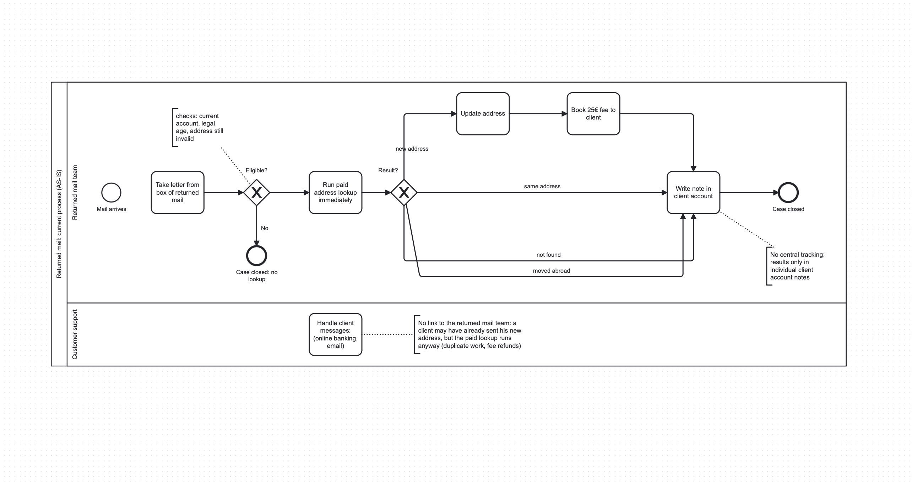
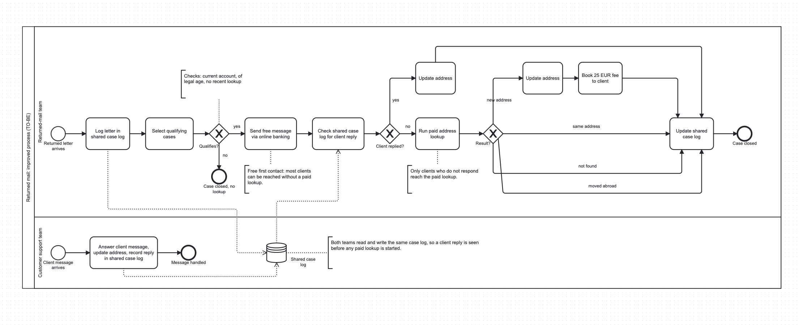

# Returned Mail Process Optimization

A small data and process-analysis project: how much does a bank-style returned-mail process cost, and how much could be saved by contacting clients for free before paying for an address lookup?

The project is **inspired by a real process I worked on as a working student**, rebuilt from scratch with **synthetic data**. No real company, customer or system data is used. All numbers in this repository are illustrative assumptions, not real figures.

> **Status: work in progress.** See the checklist at the bottom for what exists today.

## The business problem

When a letter to a client cannot be delivered, the sender gets it back ("returned mail"). Someone has to find the client's new address.

In the old process, every eligible case went straight to a **paid address lookup**:

1. Take the returned letter from the box.
2. Check eligibility: the client has a current account, is of legal age, and the address on file is still the invalid one.
3. If eligible: run a paid lookup immediately. **No free contact was tried first.**
4. The lookup returns one of four results: new address, same address, not found, moved abroad.
5. Only for a new address: update the address and book a fee to the client.
6. Write a note in the individual client account. Nothing is tracked centrally.

Two problems follow from this:

- **Avoidable cost.** Most clients can be reached for free (for example through online banking), but a paid lookup was run for nearly every eligible case.
- **No coordination between teams.** A client may already have sent in a new address to the customer support team, but nobody had read the message yet. The returned-mail team then paid for a lookup anyway, which created duplicate work and fee refunds.

## The redesign

- All letters are logged in **one shared case log** that both teams use.
- Work is split into two roles: logging the letters, and selecting the cases that qualify.
- Every qualifying client gets a **free message** through online banking first.
- Only clients who **do not respond** are escalated to the paid lookup.
- The customer support team answers replies and records them in the same log, so a reply is seen before any paid lookup starts.
- Written and video guides let junior staff run the process without pulling in a permanent employee to train each new person.

## The process, before and after

**Before (AS-IS):**



**After (TO-BE):**



The diagrams are drawn in BPMN 2.0 with [bpmn.io](https://bpmn.io). The editable `.bpmn` files are in the same folder.

## How the simulation works

`src/generate_data.py` simulates returned-mail cases with a seeded random number generator, so results are reproducible. Each case is a function that returns a dictionary with the outcome, the cost and the fee.

- `process_case_before()`: eligibility check (with a small error rate), then a paid lookup for every eligible case. A fraction of lookups are unnecessary because the client had already sent in a new address.
- `process_case_after()`: the same eligibility check with a lower error rate, then a free message first. Only clients who do not respond go to the paid lookup.
- `run_month()`: runs one of these functions many times and collects the cases.

The script exports 4,000 cases per process to `data/cases.csv`, with a `process` column ("before" / "after").

**Assumptions (all illustrative, easy to change at the top of the file):**

| Assumption | Value |
|---|---|
| Share of cases that are eligible | 80% |
| Error rate in the eligibility check, before / after | 8% / 2% |
| Share of clients who respond to the free message | 40% |
| Share of lookups that were unnecessary (before only) | 10% |
| Cost of one paid lookup | 7.60 EUR |
| Fee charged to the client, only when a new address is found | 25.00 EUR |

The 40% response rate is an assumption, not a measured value. A sensitivity check on it is planned.

## Preliminary results (simulation, seed 42)

| Per case | Before | After |
|---|---|---|
| Lookup cost | 5.80 EUR | 3.63 EUR |
| Fee income | 2.85 EUR | 1.80 EUR |
| Net cost (cost minus fee) | 2.95 EUR | 1.83 EUR |

About 30% of cases in the new process are resolved for free. Fee income also falls, because new addresses found for free earn no fee, so net cost is the fairer comparison. These results follow from the assumptions above; they show the size of the effect under those assumptions and are not proof of real savings.

## Project structure

```
src/            Python code that generates the synthetic cases
data/           generated CSV files
analysis/       SQL queries and KPI results (planned)
dashboard/      Power BI file (planned)
process/        BPMN diagrams (AS-IS, TO-BE)
presentation/   short summary of findings (planned)
```

## KPIs

- Cost per case, before vs. after
- Net cost per case (lookup cost minus fee income)
- Share of cases resolved without a paid lookup
- Number of unnecessary lookups
- Sensitivity of the saving to the response rate (planned)

## Tools and skills

| Skill | Where it is used |
|---|---|
| Python (loops, functions, dictionaries, random simulation, pandas export) | `src/generate_data.py` |
| BPMN 2.0 process modelling | `process/` |
| Git and GitHub | whole project |
| SQL | KPI queries (planned) |
| Power BI | before/after dashboard (planned) |

## How to run

```
python3 -m venv venv
source venv/bin/activate        # Windows: venv\Scripts\activate
pip install pandas numpy
python3 src/generate_data.py
```

## Limitations

- The data is synthetic. The results show how the model behaves under the stated assumptions, not what a real organization saves.
- Response rates and error rates are assumed, not measured.
- The model has no waiting period before a non-responder is escalated, and it does not model staffing or the two roles.
- Real-world effects such as client satisfaction or legal rules are not modelled.

## Why this project exists

I'm learning Python by building this from scratch, one concept at a time, rather than generating it wholesale. The commit history reflects that.

## Status

- [x] Project setup and environment
- [x] Simulation of the old process (`process_case_before`)
- [x] Simulation of the new process (`process_case_after`)
- [x] Monthly simulation loop and CSV export
- [x] AS-IS and TO-BE process diagrams
- [ ] SQL database and KPI queries
- [ ] Power BI dashboard
- [ ] Sensitivity check on the response rate
- [ ] Summary of findings